# Component Architecture & UI Hierarchy

## 1. Top-Level Component Tree

```mermaid
graph TD
    App["src/App.tsx (Root Container)"] --> Header["src/components/UI/HeaderBar.tsx"]
    App --> Scene["src/components/Scene/CampusScene.tsx"]
    App --> Controls["src/components/Audio/PlayerControls.tsx"]
    App --> ChatBar["src/components/Room/FloatingRoomChatBar.tsx"]
    App --> PlaylistMod["src/components/Audio/PlaylistModal.tsx"]
    App --> RoomMod["src/components/Room/PrivateRoomModal.tsx"]
    App --> ConfessMod["src/components/Community/ConfessionModal.tsx"]
    App --> PhotoMod["src/components/Community/PhotoCardModal.tsx"]
    App --> DevMod["src/components/Community/DeveloperModal.tsx"]

    Scene --> Rain["src/components/Scene/RainCanvas.tsx"]
    Scene --> Hotspots["Interactive Character Hotspots (18x)"]
    Scene --> SpeechBubbles["src/components/Scene/CharacterBubble.tsx"]
    Scene --> LiveRoomBubbles["src/components/Scene/LiveRoomSpeechBubble.tsx"]
```

---

## 2. Component Directory Responsibilities

### UI Layer (`src/components/UI/`)
- **`HeaderBar.tsx`**: Top navigation header featuring SEU Adda brand logo, live online student counter, live Dhaka time, Dhaka weather status, active room badge with countdown, mood selector pills (`adda`, `heartbreak`, `exams`, `canteen`), and modal trigger buttons.

### Scene Layer (`src/components/Scene/`)
- **`CampusScene.tsx`**: Renders the background campus artwork (day/night versions), manages horizontal pan/touch-drag scrolling, houses 18 character hotspots, and anchors floating speech bubbles.
- **`RainCanvas.tsx`**: High-performance HTML5 Canvas animation producing realistic rain streaks across the screen.
- **`CharacterBubble.tsx`**: Renders temporary speech bubbles triggered by local hotspot taps.
- **`LiveRoomSpeechBubble.tsx`**: Renders real-time chat messages from remote room participants above their character avatar for 30 seconds.

### Audio Layer (`src/components/Audio/`)
- **`PlayerControls.tsx`**: Bottom fixed glassmorphism audio player toolbar displaying song title, artist, play/pause toggle, next/previous buttons, playlist opener, and volume slider.
- **`PlaylistModal.tsx`**: Modal drawer allowing users to switch between curated campus playlists or paste custom YouTube URLs.

### Room Layer (`src/components/Room/`)
- **`PrivateRoomModal.tsx`**: Ephemeral 2-hour private room management dialog. Handles room creation, code joining, live taken-character querying, song syncing, participant list, and chat history.
- **`FloatingRoomChatBar.tsx`**: Compact floating chat input dock anchored at the bottom of the screen during active room sessions.

### Community Layer (`src/components/Community/`)
- **`ConfessionModal.tsx`**: Anonymous student confession wall with batch/dept attribution and real-time like counters.
- **`PhotoCardModal.tsx`**: Canvas-based social photo card generator with custom greetings, character stickers, and instant PNG download.
- **`DeveloperModal.tsx`**: Creator profile card for Fahim Shahir and the Alumni Corner featuring bKash micro-treats.

