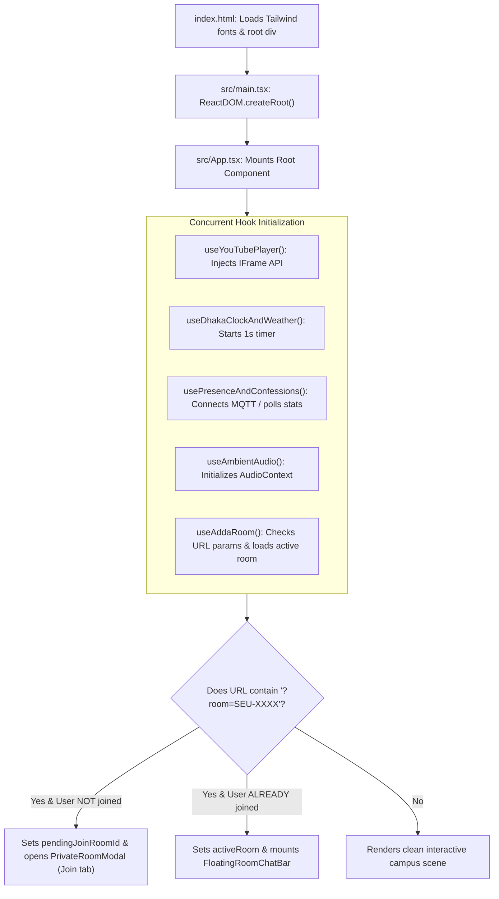

# Execution Flow & Application Lifecycle

## 1. Application Bootstrap & Mount Lifecycle

---

## 2. Room Join & Character Deduplication Lifecycle

1. **User Enters Code**: User inputs `SEU-TYXJ` into the Join Room input field.
2. **Debounced Query**: After 350ms, `PrivateRoomModal.tsx` queries `./api/rooms.php?action=get&room_id=SEU-TYXJ`.
3. **Map Construction**: Backend returns participants. Frontend builds `takenCharactersMap: Record<string, string>`.
4. **UI Render**: Occupied avatars are marked with red `🔒 [Owner Name]` badges and disabled.
5. **Auto-Selection**: If the guest's currently selected avatar is in the taken map, the system automatically selects the first available avatar of the same gender.
6. **Submission**: Guest clicks *"🚪 রুমে প্রবেশ করুন"*. Frontend dispatches join request to server.
7. **Server Verification**: `rooms.php?action=join` verifies no concurrent collision occurred. If taken, it reassigns to another free character and returns `{ success: true, characterId, wasReassigned: true }`.
8. **State Activation**: Client updates local participant state and starts real-time message polling.

