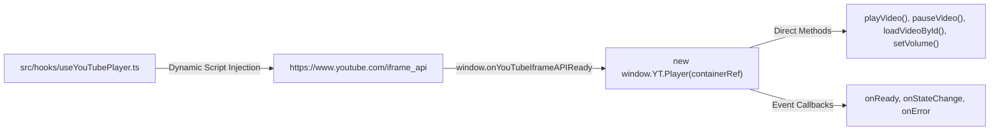

# Integration Architecture & External Services

## 1. YouTube IFrame Player API Integration

- **Player Configuration**: Hidden 1x1 pixel iframe (`playerVars: { controls: 0, showinfo: 0, rel: 0, modestbranding: 1 }`).
- **Buffering Broadcast Optimization**: Player state `YT.PlayerState.BUFFERING` (3) immediately triggers room song broadcasting before playback begins, eliminating cross-device sync lag.

---

## 2. EMQX Cloud MQTT Public Broker Integration

- **Broker Endpoint**: `wss://broker.emqx.io:8084/mqtt`
- **Protocol**: MQTT 3.1.1 / 5.0 over secure WebSockets.
- **Client Identity**: `seu_${userId}_${randomHex}`.
- **Topics**:
  - `seu-adda/rooms/{roomId}/state`: Retained topic containing full room state JSON.
  - `seu-adda/rooms/{roomId}/events`: Non-retained ephemeral events (chat messages, speech bubbles, character transfers).
  - `seu_campus_adda/global_confessions_v1`: Global broadcast for public campus memories.

