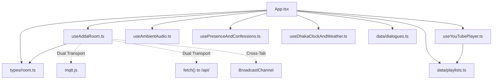

# Module Dependency Graph & Code Relationships

---

## 1. Upstream / Downstream Module Dependencies

1. **`src/types/room.ts` (Core Domain Schema)**:
   - Zero dependencies. Exported types (`AddaRoom`, `RoomParticipant`, `ChatMessage`, `CampusCharacter`, `RoomSong`) are consumed by `App.tsx`, `useAddaRoom.ts`, `CampusScene.tsx`, and `PrivateRoomModal.tsx`.
2. **`src/hooks/useAddaRoom.ts` (Real-Time State Orchestrator)**:
   - Primary state hook for private rooms. Manages local state, socket connections, API polling, character reassignment, speech bubble triggering, and audio synchronization callbacks.
3. **`src/hooks/useYouTubePlayer.ts` (Headless Media Controller)**:
   - Injects the YouTube IFrame API script tag dynamically, creates a singleton `YT.Player` instance, and coordinates song switching with `useAddaRoom`.
4. **`src/hooks/usePresenceAndConfessions.ts` (Global Presence & Wall)**:
   - Connects to global MQTT topic `seu_campus_adda/global_confessions_v1` or polls `/api/confessions.php` and `/api/stats.php`.

