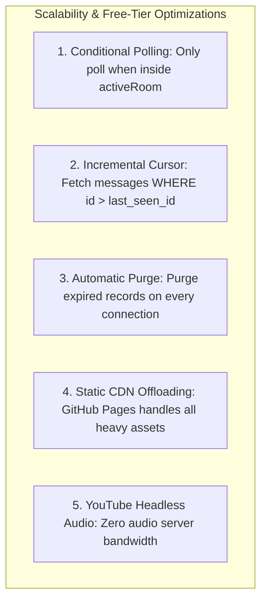

# Scalability Design & Free-Tier Optimization

## 1. Operating Within Free-Tier Hosting Limits

Deploying a real-time web application on free hosting requires defensive architectural engineering:

1. **Zero Wasted Background Polling**:
   - Polling intervals (`msgPollInterval` and `roomPollInterval`) in `useAddaRoom.ts` are mounted ONLY when `activeRoom?.id` is truthy. Inactive visitors generate 0 server requests.
2. **Incremental High-Performance SQL Indexing**:
   - `SELECT ... FROM messages WHERE room_id = :room_id AND id > :after_id` uses the composite index `idx_msg_poll (room_id, id)`. Lookups are `O(log N)` index seeks, never table scans.
3. **Automatic Garbage Collection**:
   - `purgeExpiredRooms($pdo)` runs on every database connection with `O(1)` index lookups on `idx_expires (expires_at)` and cascades deletions to `participants` and `messages`.

