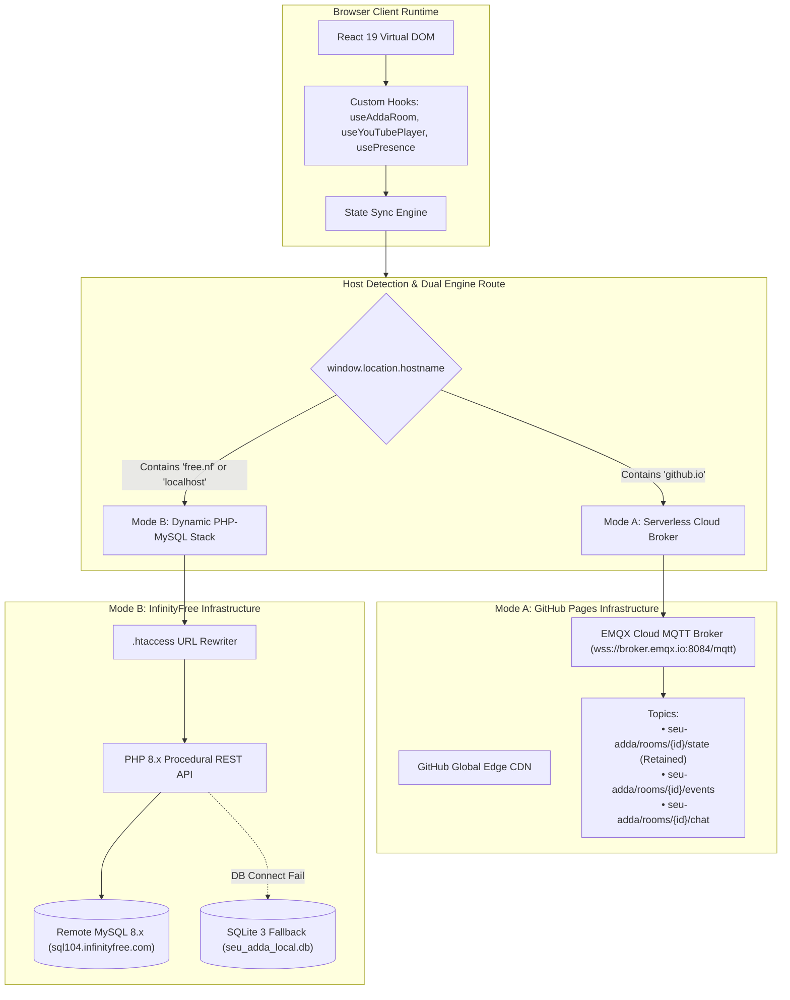

# System Architecture & Dual-Deployment Model

## 1. Architectural Pattern: Hybrid Dual-Deployment

SEU Adda employs an innovative **Hybrid Dual-Deployment Pattern** designed to run without code branching across two vastly different hosting platforms:

---

## 2. Mode A: GitHub Pages (Serverless Cloud MQTT)

- **Target Domain**: `https://fahimshahir.github.io/seu-adda/`
- **Hosting**: Static file delivery via GitHub Pages Edge CDN.
- **Backend**: Zero server-side code execution.
- **Real-Time Layer**: Direct browser-to-broker WebSocket connection using **MQTT.js** over TLS (`wss://broker.emqx.io:8084/mqtt`).
- **State Storage**:
  - Room state is stored on the broker as an **MQTT Retained Message** on `seu-adda/rooms/{roomId}/state`. When a guest connects, the broker immediately transmits the retained state.
  - Ephemeral user events (speech bubbles, song changes, transfers) stream on `seu-adda/rooms/{roomId}/events` with QoS 0.
  - Cross-tab synchronization in the same browser runs via `BroadcastChannel('seu_adda_room_bus')`.

---

## 3. Mode B: InfinityFree (Dynamic PHP 8.x + MySQL 8.x)

- **Target Domain**: `https://seuadda.free.nf/`
- **Hosting**: Apache webserver on InfinityFree with `.htaccess` mod_rewrite.
- **Backend API**:
  - `/api/rooms.php`: Room creation, joining, live querying, character transfer, heartbeat, song change.
  - `/api/messages.php`: 1.6-second polling and message dispatch with auto-healing.
  - `/api/confessions.php`: Campus confession submission, pagination, atomic likes.
  - `/api/stats.php`: Campus cheers counter and mood distribution.
- **Database Engine**:
  - Primary: Remote MySQL 8.x (`sql104.infinityfree.com`, `if0_43397321_seu_adda`) via PDO with UTF8MB4.
  - Fallback: Local SQLite 3 (`seu_adda_local.db`) initialized automatically if MySQL is unreachable during local testing.
- **Real-Time Layer**:
  - High-frequency HTTP polling: 1.6s for incoming chat messages; 2.0s for room state & song updates.
  - Heartbeat updates: Every 5s to keep participant `last_seen` timestamps fresh.

