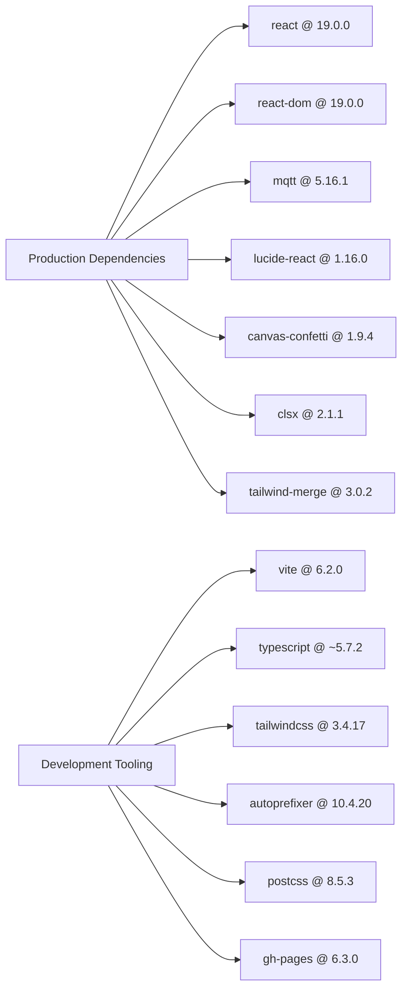

# Frameworks, Libraries & Runtime Versions

## 1. Runtime Environment Compatibility

| Component | Minimum Supported Version | Recommended Production Version | Verification Command |
|---|---|---|---|
| **Node.js** | `v20.0.0` | `v22.x LTS` | `node -v` |
| **npm** | `v9.0.0` | `v10.x` | `npm -v` |
| **PHP** | `v8.0.0` | `v8.2+` (with `pdo_mysql`, `pdo_sqlite`) | `php -v` |
| **MySQL** | `v8.0` | `v8.0.35+` (InnoDB, utf8mb4) | `SELECT VERSION();` |
| **SQLite** | `v3.30+` | `v3.40+` | `sqlite3 --version` |

---

## 2. Dependency Tree & Package Roles

---

## 3. Browser Compatibility Matrix

| Browser | Minimum Version | Desktop Status | Mobile Status | Key Supported Features |
|---|---|---|---|---|
| **Google Chrome / Chromium** | `90+` | 🟢 Verified | 🟢 Verified | WebSocket, Touch Events, Canvas, Web Audio |
| **Mozilla Firefox** | `88+` | 🟢 Verified | 🟢 Verified | Full CSS Grid, Flexbox, AudioContext |
| **Apple Safari** | `14+` | 🟢 Verified | 🟢 Verified | Touch drag, YouTube IFrame, Bengali rendering |
| **Microsoft Edge** | `90+` | 🟢 Verified | 🟢 Verified | Chromium parity |
| **Samsung Internet** | `15+` | N/A | 🟢 Verified | Mobile drag-scroll, speech bubbles |

