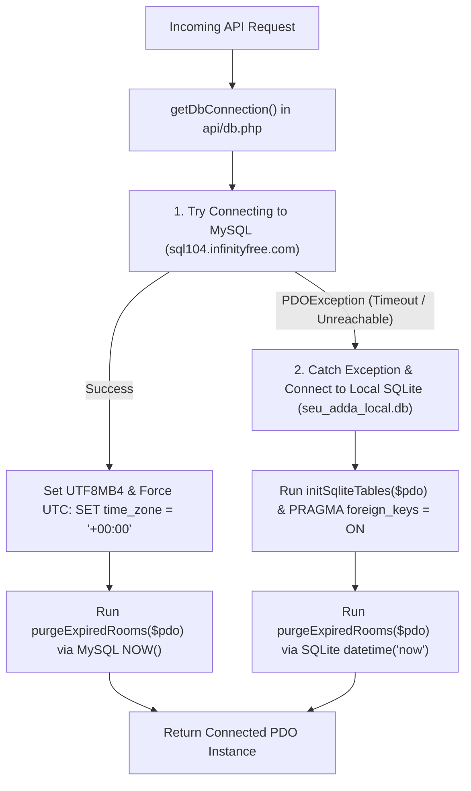

# Database Architecture & Storage Strategy

## 1. Dual-Engine Storage Architecture

The database system is engineered to handle both cloud hosting on InfinityFree and offline local testing through a **PDO Dynamic Driver Factory**:

---

## 2. Character Set & Collation Standard

- **Engine**: `InnoDB`
- **Charset**: `utf8mb4`
- **Collation**: `utf8mb4_unicode_ci`
- **Significance**: Complete support for Bengali characters (যুক্তাক্ষর, হসন্ত, চন্দ্রবিন্দু) and emoji characters (☕, 🎸, 💔, 📚, 🔥, 🤣, 🎉) across room names, user names, confessions, and chat text without character corruption or truncation.

---

## 3. Universal UTC Timezone Harmonization

To prevent timezone mismatches between shared PHP servers (which may run in Europe or US timezones) and Bangladeshi client browsers (UTC+6):
1. **PHP Timezone**: `date_default_timezone_set('UTC')` executes on script boot in `api/config.php`.
2. **MySQL Timezone**: `$pdo->exec("SET time_zone = '+00:00'")` executes immediately after establishing every database connection in `api/db.php`.
3. **UTC Queries**: All timestamp comparisons evaluate against UTC (`expires_at <= NOW()` or `expires_at <= gmdate('Y-m-d H:i:s')`).

