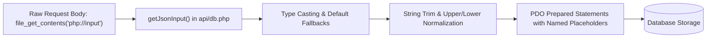

# Data Validation & Sanitization Framework

## 1. Input Sanitization Architecture



## 2. Character Exclusivity Validation (`action=join`)

```php
// Query all currently occupied character IDs in the room
$takenStmt = $pdo->prepare("SELECT character_id FROM participants WHERE room_id = :room_id");
$takenStmt->execute([':room_id' => $roomId]);
$takenCharacters = $takenStmt->fetchAll(PDO::FETCH_COLUMN);

// If requested character is already taken, automatically find first free character
if (in_array($characterId, $takenCharacters, true)) {
    // 1. Try free character of same gender
    // 2. Fall back to any free character
    // Return reassigned character with wasReassigned = true
}
```
This guarantees that concurrent join requests can never bypass character exclusivity.

