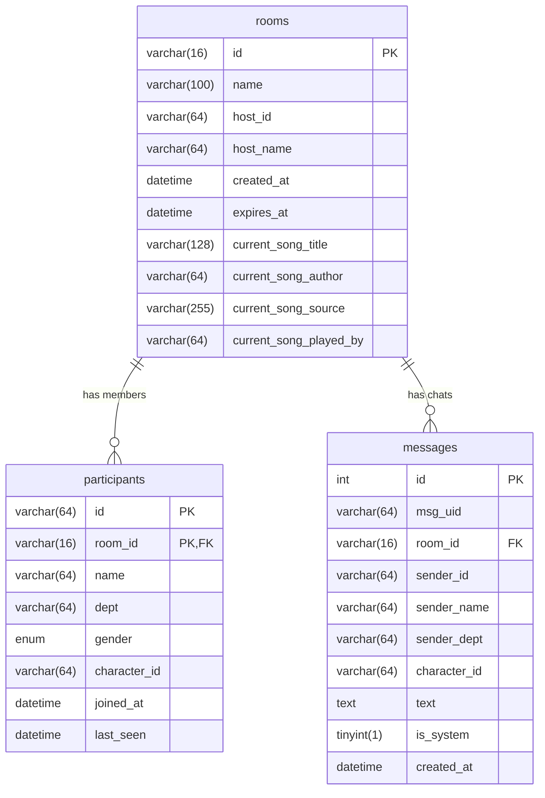

# Entity Relationships & Referential Integrity

## Cascade Deletion Rules
- **Foreign Key `fk_part_room`**: `participants.room_id` references `rooms.id` with `ON DELETE CASCADE`. When an expired room is deleted, all participant records are automatically removed.
- **Foreign Key `fk_msg_room`**: `messages.room_id` references `rooms.id` with `ON DELETE CASCADE`. When an expired room is deleted, all associated chat records are instantly cleared.

