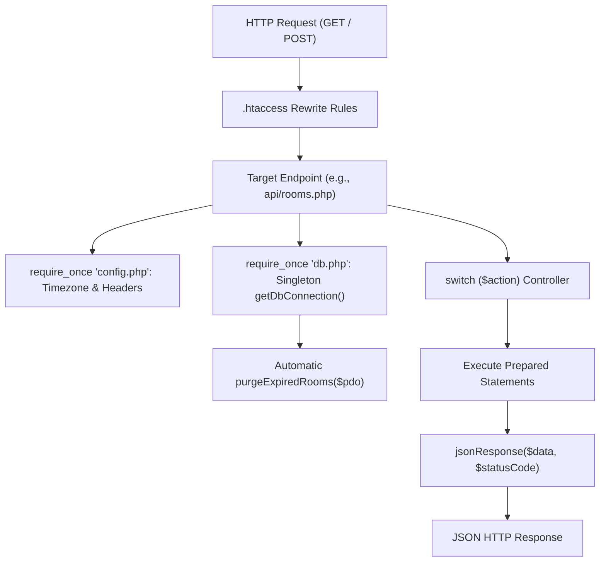

# Backend Architecture & Procedural REST Pattern

## 1. Architectural Style: Lightweight Procedural REST

SEU Adda's backend is implemented using a high-efficiency **Lightweight Procedural REST Pattern** optimized specifically for shared PHP hosting:

### Why Procedural instead of Heavy OOP Framework?
1. **Cold-Start Elimination**: Heavy PHP frameworks (Laravel, Symfony) load hundreds of classes per request, creating latency spikes on free shared hosting. Procedural scripts initialize in under 5ms.
2. **Minimal Memory Footprint**: Memory usage remains below 2 MB per request, ensuring immunity against host memory limit crashes.
3. **Transparent Execution**: Zero magic reflection, complex dependency injection containers, or hidden middleware chains.

