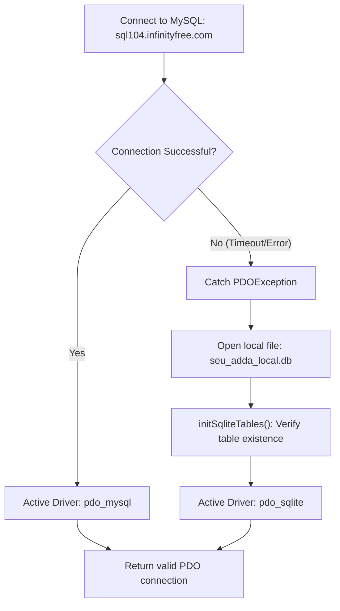

# Error Handling & Resilience Architecture

## 1. Fail-Safe Database Recovery Flow

## 2. Auto-Healing Architecture
If a user is inside a room on their client, but the server table lost the room record due to clock anomalies, sending a chat message triggers an immediate auto-healing query in `messages.php`. This guarantees the message is saved and subsequent polling succeeds without 404 drops.

