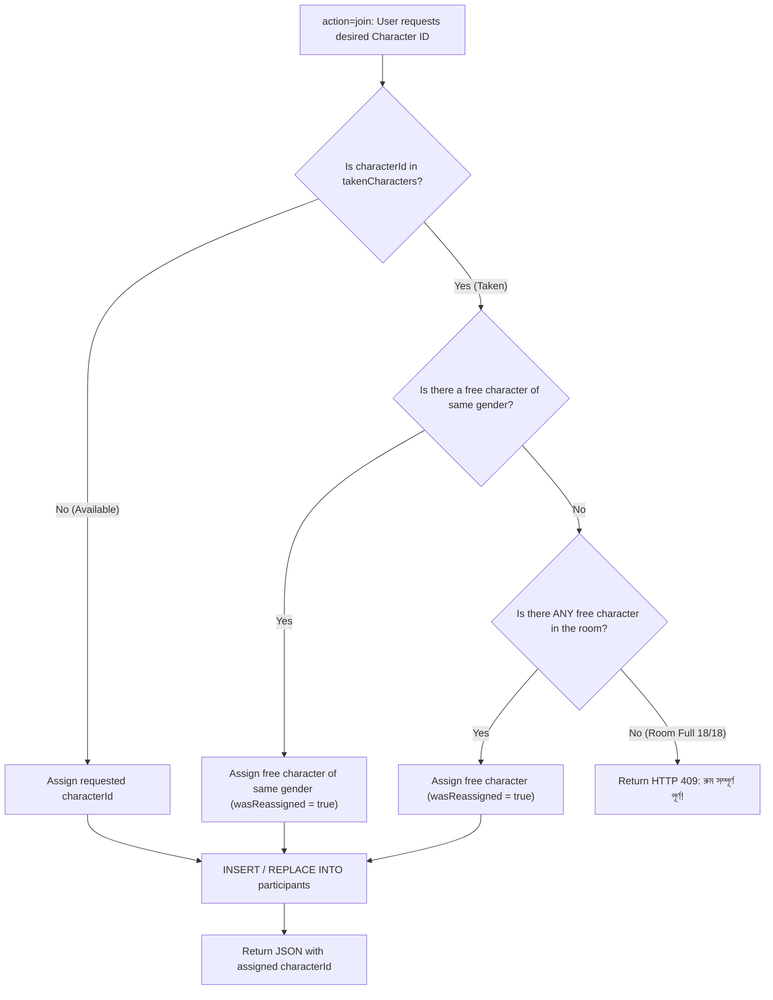

# Backend Services & Business Logic Implementation

## 1. Character Reassignment Algorithm (`rooms.php`)



## 2. Auto-Healing Room Restoration (`messages.php`)

```php
// Check if room exists
$stmt = $pdo->prepare("SELECT id FROM rooms WHERE id = :id");
$stmt->execute([':id' => $roomId]);
if (!$stmt->fetch()) {
    // Room was prematurely purged by timezone mismatch or host crash!
    // Auto-heal the room record with fresh 2-hour TTL
    $nowUtc = gmdate('Y-m-d H:i:s');
    $expiresUtc = gmdate('Y-m-d H:i:s', time() + 7200);
    $healStmt = $pdo->prepare("
        INSERT IGNORE INTO rooms (id, name, host_id, host_name, created_at, expires_at)
        VALUES (:id, :name, :host_id, :host_name, :created_at, :expires_at)
    ");
    $healStmt->execute([ ... ]);
}
// Message insertion proceeds without failure!
```

