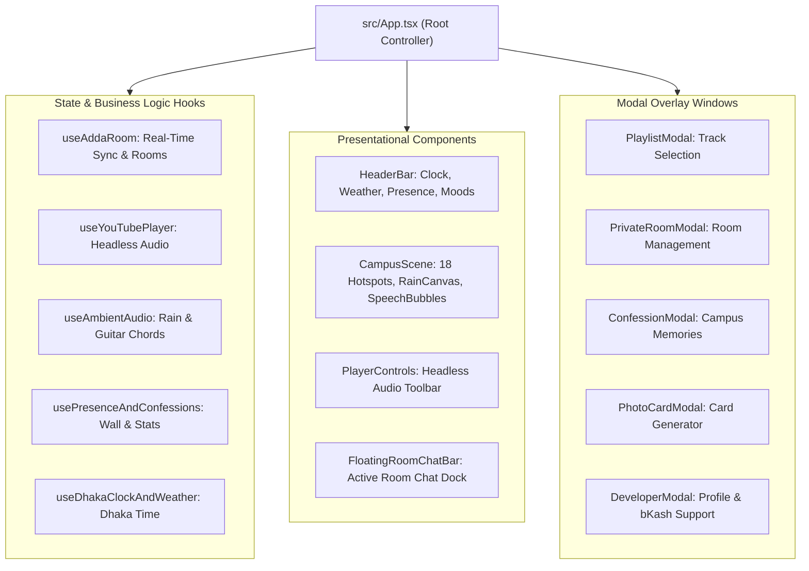

# Frontend Architecture & React 19 Engine

## 1. Declarative Single-Page Architecture

The frontend is constructed with **React 19** using functional components, standard hooks (`useState`, `useEffect`, `useCallback`, `useRef`), and pure TypeScript domain interfaces:

## 2. React 19 Optimizations
- **Automatic Batching**: All state updates in promises, timeouts, and native event listeners batch automatically.
- **Fast Re-render Isolation**: Hotspots and speech bubbles isolate their individual re-renders, preventing the entire campus artwork from re-rendering during chat typing.

