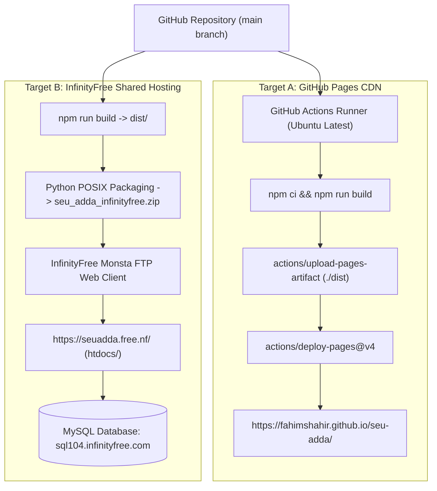

# Infrastructure Topology & Deployment Overview

## 1. Multi-Target Infrastructure Topology

---

## 2. Infrastructure Environments

1. **GitHub Pages (Production CDN)**:
   - Automated continuous deployment on every push to `main`.
   - Global CDN edge caching for static JavaScript, CSS, images, and fonts.
2. **InfinityFree Hosting (Production Full-Stack)**:
   - Hosted on `seuadda.free.nf`.
   - Apache web server with PHP 8.x CGI runtime and remote MySQL 8 database.
3. **Local Developer Workstation**:
   - Node 20+, Vite dev server on port 5173, and built-in PHP server on port 8080 with SQLite fallback.

