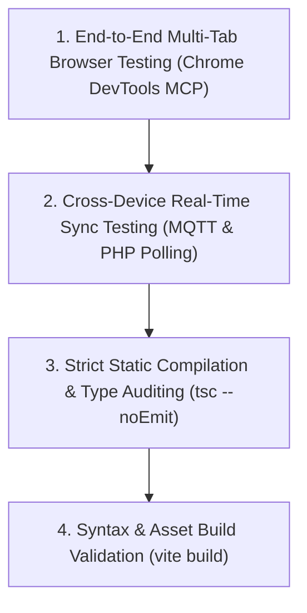

# Testing Architecture & Quality Assurance Framework

## 1. Quality Assurance Pyramid

## 2. Core Testing Principles

- **Zero Type Ambiguity**: `npx tsc --noEmit` must pass with zero errors before any code is built or packaged.
- **Multi-Tab Concurrency Verification**: Room features are verified across concurrent browser tabs to simulate independent users.
- **Cross-Host Verification**: Features are tested against both GitHub Pages (`github.io`) and InfinityFree (`free.nf`).

