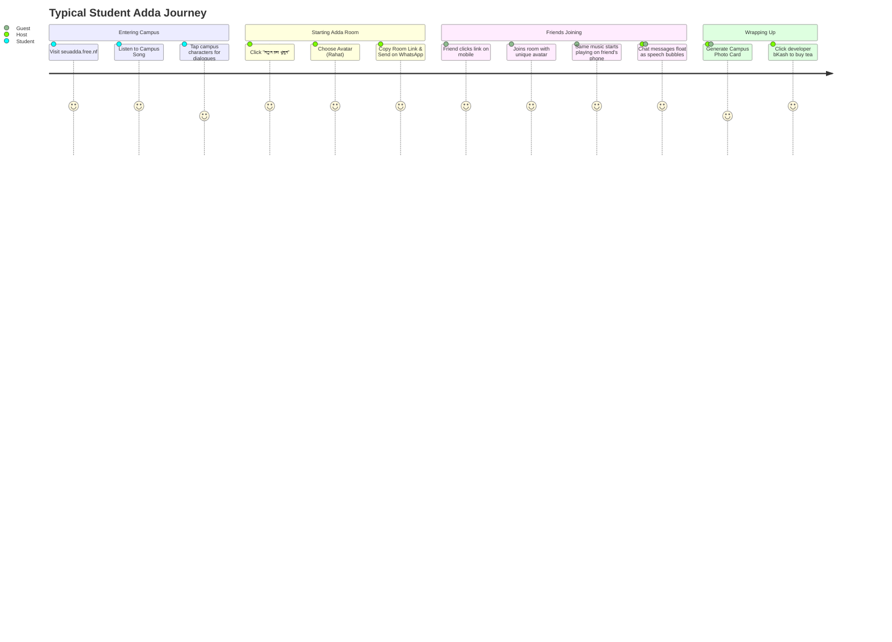

# User Journeys, Roles & Monetization Model

## 1. User Journeys Walkthrough

## 2. Micro-Treat bKash Support Model

The Alumni Corner features 4 distinct coffee micro-treat tiers:
- `চা ২০৳`: Basic campus appreciation.
- `দুধ চা ৫০৳`: Friendly alumni treat.
- `কফি ১০০৳`: Premium coffee treat.
- `স্পনসর ২০০৳+`: Platform server and domain sponsor.
Clicking any tier copies the bKash personal number (`01969091751`) and bursts colorful confetti.

