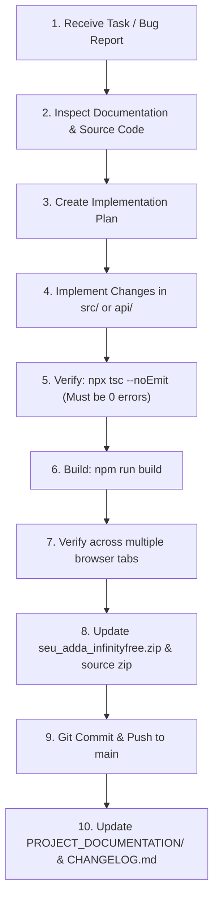

# Development Workflow & Git Branching Strategy

## 1. Git Branching Model

- **`main`**: Production-ready branch. Every push to `main` triggers automated GitHub Actions deployment.
- **`gh-pages`**: Automated deployment target branch managed by `actions/deploy-pages@v4` or `npx gh-pages`. Do not commit directly to this branch.

## 2. Standard Feature Implementation Workflow

