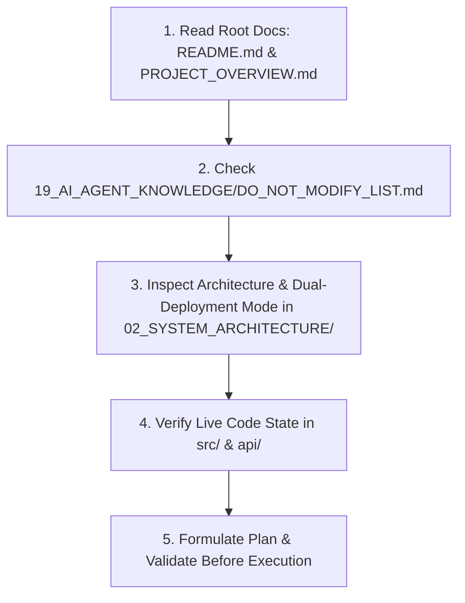

# AI Agent Startup Guide & Bootstrapping Protocol

> [!IMPORTANT]
> **MANDATORY INSTRUCTION FOR ALL AI CODING AGENTS**:
> You are operating on **SEU Adda (সাউথইস্ট বিশ্ববিদ্যালয় আড্ডাখানা)**. Before proposing or executing any code edits, running destructive terminal commands, or altering configurations, you **MUST** follow this protocol.

---

## 1. Five-Step Agent Startup Sequence

1. **Step 1: Context Absorption**
   - Read [`PROJECT_OVERVIEW.md`](./PROJECT_OVERVIEW.md) to understand the campus nostalgia mission, the 18 non-overlapping characters, and the 2-hour ephemeral room rules.
   - Read [`PROJECT_STATUS.md`](./PROJECT_STATUS.md) to check active deployment health and build metrics.
2. **Step 2: Check Safety Constraints**
   - Consult [`19_AI_AGENT_KNOWLEDGE/DO_NOT_MODIFY_LIST.md`](./19_AI_AGENT_KNOWLEDGE/DO_NOT_MODIFY_LIST.md). Never break the dual-deployment abstraction, character uniqueness algorithms, or UTC timezone harmonization.
3. **Step 3: Understand the Dual-Deployment Logic**
   - Read [`02_SYSTEM_ARCHITECTURE/SYSTEM_ARCHITECTURE.md`](./02_SYSTEM_ARCHITECTURE/SYSTEM_ARCHITECTURE.md). Remember:
     - On `https://fahimshahir.github.io/seu-adda/`: Chat & room sync run on **EMQX WebSocket MQTT**.
     - On `https://seuadda.free.nf/`: Chat & room sync run on **PHP MySQL API Polling** (`/api/*.php`).
4. **Step 4: Verify Against Actual Code**
   - Documentation is comprehensive, but the code in `src/`, `api/`, and `public/` is the ultimate source of truth. Always inspect existing implementations before assuming behavior.
5. **Step 5: Follow the Planning Rule**
   - Always formulate a clear plan before modifying files. If working in pair programming mode, verify with the user before touching core systems.

---

## 2. Inviolable Core System Invariants

When working on this repository, you must preserve these architectural invariants:
1. **Bengali Language & Campus Tone**: The UI, modal dialogues, character names, and error notices are written in warm, nostalgic, colloquial Bengali (*Bangla*). Do not replace Bengali strings with generic English.
2. **Strict 1-to-1 Character Assignment**: Under NO circumstance should two participants in the same room hold the same character avatar.
3. **Dual-Deployment Compatibility**: Any feature added to the room system must work on BOTH GitHub Pages (MQTT) and InfinityFree (PHP MySQL).
4. **POSIX Slash Zip Archives**: When creating zip files for InfinityFree (`seu_adda_infinityfree.zip`), always ensure standard forward slashes (`/`) so Monsta FTP extracts directory paths correctly.
5. **Universal UTC Timezone**: Always calculate timestamps in UTC on both client (`Date.now()`) and server (`gmdate()`, `SET time_zone = '+00:00'`) to prevent timezone drift.

---

## 3. Key Reference Pointers

- **AI Startup In-Depth**: [`19_AI_AGENT_KNOWLEDGE/AI_AGENT_STARTUP_PROTOCOL.md`](./19_AI_AGENT_KNOWLEDGE/AI_AGENT_STARTUP_PROTOCOL.md)
- **Do Not Modify List**: [`19_AI_AGENT_KNOWLEDGE/DO_NOT_MODIFY_LIST.md`](./19_AI_AGENT_KNOWLEDGE/DO_NOT_MODIFY_LIST.md)
- **Database Schema**: [`05_DATABASE_AND_DATA/DATABASE_SCHEMA.md`](./05_DATABASE_AND_DATA/DATABASE_SCHEMA.md)
- **API Reference**: [`08_API_AND_INTEGRATIONS/API_REFERENCE.md`](./08_API_AND_INTEGRATIONS/API_REFERENCE.md)
- **Troubleshooting Guide**: [`17_OPERATIONS_AND_MAINTENANCE/TROUBLESHOOTING.md`](./17_OPERATIONS_AND_MAINTENANCE/TROUBLESHOOTING.md)

