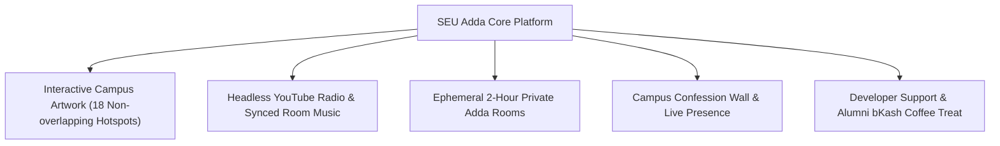
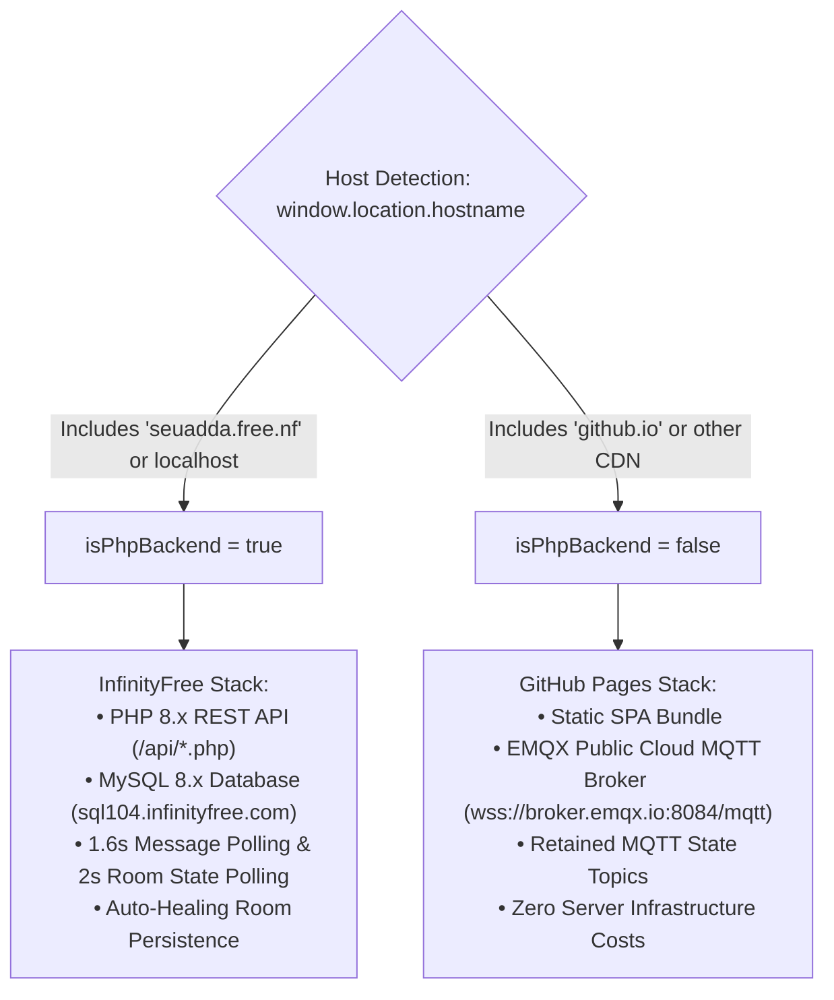

# Project Overview & Executive Architecture Summary

## 1. Executive Summary

**SEU Adda (সাউথইস্ট বিশ্ববিদ্যালয় আড্ডাখানা ☕🎸)** is a specialized, interactive virtual campus environment designed for students, alumni, and friends of **Southeast University (SEU), Bangladesh**.

The application recreates the nostalgic ambiance of university life — hanging out on campus stairs, sharing a cup of hot red tea (*"Lal Cha"*), enjoying live acoustic guitar music, exchanging campus confessions, having spontaneous dialogues across different academic departments, and creating real-time 2-hour ephemeral private *Adda* rooms with cross-device synchronized music, live speech bubbles, and instant chat.

---

## 2. Platform Core Pillars

### Pillar I: Interactive Campus Artwork (18 Characters & Hotspots)
- Custom campus background rendering day and night versions (`campus-day.jpg` and `campus-night.jpg`).
- **18 non-overlapping character hotspots** mapped to specific coordinates across three spatial zones:
  - **Foreground (সামনের সারি)**: Sadia, Nusrat, Sajid, Nishat, Samiya, Rahat, Tanvir (Acoustic Guitarist), Shakir, Abir, Siam, Mahin, Tamim, Tea Stall Mama.
  - **Midground (সিঁড়িতে)**: Tasnim, Lamia, Mehedi, Joy.
  - **Background (গেটে)**: Guard Mama, Farhan.
- **Dynamic Bengali Dialogues**: Hundreds of hilarious, authentic Bengali campus dialogues organized by mood:
  - `adda` (নস্টালজিক আড্ডা ☕)
  - `heartbreak` (ছ্যাঁকা ও ইমোশন 💔)
  - `exams` (পরীক্ষা ও অ্যাসাইনমেন্ট 📚)
  - `canteen` (ক্যান্টিন ও চা 🍵)

### Pillar II: Headless YouTube Radio & Ambient Audio
- Seamless streaming of timeless Bengali classics, campus bands (Artcell, Arnob, Shironamhin, Warfaze, Miles, LRB, Coke Studio Bangla).
- Zero visual distraction: Headless YouTube IFrame API controlled by custom glassmorphism audio player.
- Procedural HTML5 Web Audio API rain sound and acoustic guitar strum audio effects.
- Dynamic Day/Night lighting and canvas-based ambient rainfall animation.

### Pillar III: Ephemeral 2-Hour Private Adda Rooms (Dual-Engine)
- **Room Lifecycle**: Automatically expires after exactly 2 hours (7200 seconds TTL).
- **Synchronized Music**: Room host or members can switch songs; instantly syncs across all participants' devices via WebSocket (GitHub Pages) or polling (InfinityFree).
- **Real-Time Speech Bubbles**: Chat messages appear as floating speech bubbles directly over characters' heads with a 30-second TTL.
- **Strict 1-to-1 Character Assignment**: Every user in a room must hold a unique character; occupied characters are locked with `🔒 [User Name]` badges and disabled in the UI.

### Pillar IV: Community & Memory Wall
- Anonymous campus confessions with real-time like counters.
- Global campus cheering counter (*"চায়ের কাপে চিয়ার্স"*).
- Campus Photo Card generation for saving and sharing memories on social media.

### Pillar V: Developer & Alumni Corner
- Creator recognition for **Fahim Shahir** (CSE, Southeast University).
- Alumni Corner with bKash Personal integration (`01969091751`) for community coffee support.

---

## 3. Dual-Deployment Technical Strategy

SEU Adda is engineered to operate simultaneously on two completely different deployment targets without architectural friction:

---

## 4. Key Metrics and Operating Parameters

- **Room Lifespan**: 120 minutes (7,200 seconds).
- **Speech Bubble Lifespan**: 30 seconds.
- **Fast Chat Polling Interval (PHP Mode)**: 1,600 milliseconds.
- **Room State & Heartbeat Interval (PHP Mode)**: 2,000 milliseconds.
- **MySQL Participant Inactivity Purge**: 300 seconds (5 minutes grace period prevents false drops during lock screens).
- **Maximum Room Capacity**: 18 concurrent unique characters.
- **Character Pool**: 18 distinct campus avatars (10 male, 8 female).

