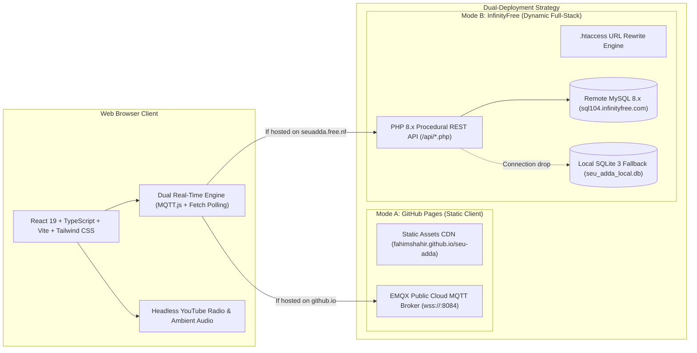

# SEU Adda — Technical Knowledge Base & System Documentation

```
  ____  _____ _   _      _       _     _       
 / ___|| ____| | | |    / \   __| | __| | __ _ 
 \___ \|  _| | | | |   / _ \ / _` |/ _` |/ _` |
  ___) | |___| |_| |  / ___ \ (_| | (_| | (_| |
 |____/|_____|\___/  /_/   \_\__,_|\__,_|\__,_|
 সাউথইস্ট বিশ্ববিদ্যালয় আড্ডাখানা • Permanent Architecture Base
```

Welcome to the **SEU Adda (সাউথইস্ট বিশ্ববিদ্যালয় আড্ডাখানা)** technical knowledge base. This documentation directory is the permanent, authoritative architectural repository designed for human engineers, system architects, and autonomous AI coding agents.

---

## 🧭 Navigation & Orientation

| Document | Purpose | Target Audience |
|---|---|---|
| [**`AI_AGENT_START_HERE.md`**](./AI_AGENT_START_HERE.md) | **Critical Bootstrapping Guide** — First mandatory stop for any AI agent | AI Agents, Pairing Assistants |
| [**`PROJECT_OVERVIEW.md`**](./PROJECT_OVERVIEW.md) | Executive summary, business purpose, and high-level platform design | Architects, Product Managers, Developers |
| [**`PROJECT_STATUS.md`**](./PROJECT_STATUS.md) | Real-time production status, dual-deployment telemetry, and metrics | DevOps, Maintainers |
| [**`DOCUMENTATION_INDEX.md`**](./DOCUMENTATION_INDEX.md) | Full hierarchical catalog of all documentation directories and modules | All Contributors |
| [**`DOCUMENTATION_RULES.md`**](./DOCUMENTATION_RULES.md) | Maintenance standards, YAML frontmatter schemas, and edit rules | Document Authors, AI Agents |
| [**`CHANGELOG.md`**](./CHANGELOG.md) | Chronological audit trail of architectural milestones and releases | Auditors, Engineers |

---

## 🏛️ Repository Architecture Snapshot

`seu-adda` is a full-stack, dual-deployment virtual campus experience built with a client-first, highly resilient architecture:



---

## 📂 Documentation Directory Structure

```text
PROJECT_DOCUMENTATION/
├── README.md                           # This knowledge root entrypoint
├── PROJECT_OVERVIEW.md                 # High-level architecture and platform summary
├── PROJECT_STATUS.md                   # Live production deployment & build telemetry
├── DOCUMENTATION_INDEX.md              # Master directory index
├── AI_AGENT_START_HERE.md              # AI agent bootstrapping protocol
├── DOCUMENTATION_RULES.md              # Documentation authoring rules
├── CHANGELOG.md                        # Version and architecture log
├── 01_PROJECT_FOUNDATION/              # Mission, vision, requirements, glossary
├── 02_SYSTEM_ARCHITECTURE/             # Architecture decisions, data flows, execution
├── 03_TECHNOLOGY_STACK/                # Tech inventory, version constraints, compatibility
├── 04_PROJECT_STRUCTURE/               # Folder roles, file mappings, entrypoints
├── 05_DATABASE_AND_DATA/               # Schemas, ERD, tables, migrations, retention
├── 06_BACKEND_SYSTEM/                  # PHP API endpoints, controllers, error handling
├── 07_FRONTEND_AND_UI/                 # React 19 component tree, UI, styling, responsiveness
├── 08_API_AND_INTEGRATIONS/            # API reference, request/response formats, protocols
├── 09_SECURITY_AND_PRIVACY/            # Threat models, sanitization, static security audit
├── 10_INFRASTRUCTURE_AND_DEPLOYMENT/   # GitHub Pages, InfinityFree, build pipelines
├── 11_TESTING_AND_QUALITY/             # Test strategy, multi-tab validation, known issues
├── 12_PERFORMANCE_AND_RELIABILITY/     # Caching, failure handling, memory profiling
├── 13_HARDWARE_AND_EMBEDDED/           # [NOT APPLICABLE - Formally recorded]
├── 14_AI_AND_DATA_SCIENCE/             # [NOT APPLICABLE - Formally recorded]
├── 15_BUSINESS_LOGIC/                  # Room rules, character uniqueness, bKash support
├── 16_DEVELOPMENT_GUIDELINES/          # Coding guidelines, extension recipes, pitfalls
├── 17_OPERATIONS_AND_MAINTENANCE/      # Troubleshooting, maintenance, disaster recovery
├── 18_PROJECT_ROADMAP/                 # Current capabilities, debt, roadmap
├── 19_AI_AGENT_KNOWLEDGE/              # Startup rules, DO NOT MODIFY list, agent handover
├── 20_REFERENCES_AND_DIAGRAMS/         # Comprehensive diagrams (ERD, sequence, flowcharts)
└── 99_AUDIT_AND_VALIDATION/            # Repository coverage and final completion audit
```

---

## ⚡ Developer & AI Quick Start

- **Install Dependencies**: `npm install`
- **Run Local Development Server**: `npm run dev` (Runs Vite on `http://localhost:5173`)
- **Run Local PHP Testing Server**: `php -S localhost:8080 -t dist` (Runs PHP backend with SQLite fallback)
- **Compile Production Bundle**: `npm run build` (`tsc && vite build`)
- **Deploy to GitHub Pages**: `npx gh-pages -d dist` (Or push to `main` branch for GitHub Actions)
- **Deploy to InfinityFree**: Upload `seu_adda_infinityfree.zip` to InfinityFree Monsta FTP `htdocs/` and extract.

---

> [!IMPORTANT]
> **Source Code Authority Principle**:
> While this documentation system is continuously maintained to be 100% accurate, the actual implementation in `src/`, `api/`, and `public/` is the ultimate source of truth. If any conflict is discovered between code and documentation, verify against code, update the documentation, and record it in [CHANGELOG.md](./CHANGELOG.md).

